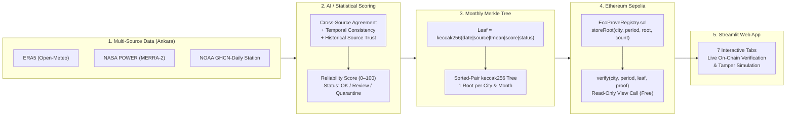

# 🌍 EcoProve AI — Climate Data Trust & Verification Layer

**Live Web App:** [https://ecoprove-ai.streamlit.app](https://ecoprove-ai.streamlit.app)  
**Track:** IEEE Global ClimateChain Hackathon 2026 — *Track 4: Climate Data & Environmental Monitoring*  
**Smart Contract (Ethereum Sepolia):** [`0x2b27fd49fd0C8325f8FE389a49BDDde1d6feCF89`](https://sepolia.etherscan.io/address/0x2b27fd49fd0C8325f8FE389a49BDDde1d6feCF89)

---

## 🎯 Problem & Motivation

Climate-sensitive decisions—such as **weather-index (parametric) crop insurance**, **solar and wind energy planning**, and **municipal climate reporting**—rely on daily weather thresholds (e.g., *"Did the temperature drop below 0 °C?"*).

However, different climate data sources (reanalysis models, satellite products, and ground stations) frequently report **different numbers for the same day and location**. When a threshold is crossed in one source but not another, the financial or operational decision changes. Furthermore, once climate datasets are downloaded into spreadsheets, there is no simple way for an auditor or insurer to verify whether records were altered afterwards.

**EcoProve AI** does not claim to know the "absolute truth." Instead, it provides a **data trust and traceability layer** that:
1. **Scores** how reliable each daily climate reading is (0–100) and flags suspicious records (`OK`, `Review`, `Quarantine`).
2. **Seals** monthly batches of scored records into a compact **Merkle root** on the Ethereum Sepolia blockchain.
3. **Verifies** any single record in the browser (free, read-only, no wallet needed) and immediately detects post-seal tampering.

---

## 🏗️ System Architecture



### Why Monthly Merkle Roots?
Writing every daily climate row directly to a blockchain is expensive and does not scale. By grouping records into a **monthly Merkle tree**:
- **1 transaction per city per month** (12 transactions/year per city, regardless of how many stations or variables are included).
- **Zero raw data on-chain**, keeping gas costs minimal while preserving **100% single-record verifiability** via compact Merkle proofs ($\approx 7$ hashes per proof).

---

## ✨ Web Application Features (9 Interactive Tabs)

Open the live dashboard at **[https://ecoprove-ai.streamlit.app](https://ecoprove-ai.streamlit.app)**:

| Tab | What It Does |
|---|---|
| 📊 **Overview** | KPI summary cards (`Trusted`, `Review`, `Quarantined`, `Missing`), daily reliability score curves, status breakdown, Day × Source heatmap, and CSV export. |
| 🔀 **Source Comparison** | Side-by-side comparison across NASA POWER, Open-Meteo ERA5, and NOAA GHCN-Daily, daily spread (`max − min`), and a **Day Inspector** table. |
| 📈 **AI Expected Band** | LightGBM 90% expected interval (`[expected_low, expected_high]`) with zero data leakage and 2022–2026 walk-forward validation metrics (`1.39 °C` MAE in 2026 vs `1.56 °C` persistence). |
| 🧪 **Fault Benchmark** | Synthetic fault injection results (`100%` spike & unit error detection, `81.2%` stuck sensor, `68.9%` drift, overall **F1 `0.865`** vs Heston-style baseline `0.148`) and real heatwave preservation. |
| 🎯 **Threshold Check** | Evaluates real decision rules (e.g., freezing day `< 0 °C` or custom rules) to show on how many days sources disagree and how many of those days EcoProve flagged as `Review`/`Quarantined`. |
| 🏆 **Source Trust** | Ranks data sources by average reliability score, status distribution, and missing station days across all 44 months (`2023-01` to `2026-08`). |
| 🔗 **Verify on Chain** | Rebuilds the Merkle leaf and proof locally, calls `verify()` on the Sepolia smart contract, exports standalone JSON proofs, and includes an interactive **Tamper Test**. |
| 📜 **Seal Registry** | Checks all 44 months in the dataset against the smart contract to confirm which monthly roots are sealed and matching. |
| ℹ️ **About & Limits** | System architecture diagram (`2020–2026`), scoring formula ($z_{\text{eff}} = z_{\text{cross}} + z_{\text{interval}} + 3 \times \text{repeat}$), use cases, and honest system boundaries. |

---

## 🔗 Smart Contract & On-Chain Proof

- **Network:** Ethereum Sepolia Testnet (`chainId: 11155111`)
- **Contract (`EcoProveRegistry.sol`):** [`0x2b27fd49fd0C8325f8FE389a49BDDde1d6feCF89`](https://sepolia.etherscan.io/address/0x2b27fd49fd0C8325f8FE389a49BDDde1d6feCF89)
- **Owner / Writer Wallet:** [`0x471F4ac021b9a4E72626fbd51C6119459052b494`](https://sepolia.etherscan.io/address/0x471F4ac021b9a4E72626fbd51C6119459052b494)
- **Example `storeRoot` Transactions:**
  - [`0x0770f86d572b61fd7379b86c0fe40d61616790a7ec7ab3033dc4a6c39763cbb7`](https://sepolia.etherscan.io/tx/0x0770f86d572b61fd7379b86c0fe40d61616790a7ec7ab3033dc4a6c39763cbb7)
  - [`0x110fd611077215212ddb4848df00d8e2a9c91966e1a6cb70d382fa9721a4c650`](https://sepolia.etherscan.io/tx/0x110fd611077215212ddb4848df00d8e2a9c91966e1a6cb70d382fa9721a4c650)

### Key Contract Guarantees (Verified by 6 Hardhat Unit Tests)
1. **Immutability (`already stored`):** Once a `(city, period)` root is sealed, it can never be overwritten—not even by the contract owner.
2. **Access Control (`only owner`):** Only the authorized publisher wallet can seal new monthly roots.
3. **Public Verification (`verify`):** Anyone can verify a record and its Merkle proof via a free `view` call without a wallet or gas.

---

## 🛠️ Local Setup & Reproducibility

### 1. Run Smart Contract Tests (Hardhat)
```bash
npm install
npx hardhat test
```
Expected output: **`6 passing`** (see screenshots in [`kanitlar/`](./kanitlar)).

### 2. Recompute Monthly Merkle Roots
```bash
python -m pip install -r requirements.txt
python merkle_kok.py data/reliability_scores_v1.csv merkle_roots.csv
```

### 3. Check or Seal Roots on Sepolia
Dry-run (reads the contract, sends no transactions):
```bash
python store_roots.py --csv merkle_roots.csv --city TEST --limit 3
```

### 4. Launch the Web Application Locally
```bash
python -m streamlit run app.py
```

---

## 🛡️ Honest Boundaries & Security Notes

- **Tamper-evidence vs. physical truth:** The blockchain proves that a record **was not altered after sealing**; it does **not** prove a thermometer was physically accurate.
- **Role separation:** Cross-checking and anomaly detection are performed off-chain by the **scoring pipeline**; the blockchain **seals** the resulting score and status.
- **Source independence:** Reanalysis datasets (ERA5, MERRA-2) assimilate observational data, so the three sources are not 100% statistically independent.
- **Scope:** Prototype focused on Ankara, Türkiye, deployed on the Ethereum Sepolia testnet.
- **Secret management:** Private keys are stored only in local `.env` (excluded via `.gitignore`) and are never required by the web application.

More details: see [`SECURITY_AND_INTEGRITY.md`](./SECURITY_AND_INTEGRITY.md).

---

## 👥 Team

- **Team:** 2 Computer Engineering students (Blockchain & Web Application · Data Science, Scoring & Forecasting).
