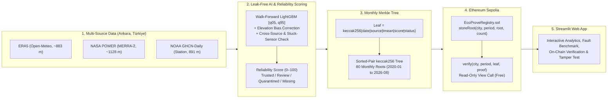

# 🌍 EcoProve AI — Climate Data Trust & Verification Layer

**Live Web App:** [https://ecoprove-ai.streamlit.app](https://ecoprove-ai.streamlit.app)  
**Track:** IEEE Global ClimateChain Hackathon 2026 — *Track 4: Climate Data & Environmental Monitoring*  
**Smart Contract (Ethereum Sepolia):** [`0x2b27fd49fd0C8325f8FE389a49BDDde1d6feCF89`](https://sepolia.etherscan.io/address/0x2b27fd49fd0C8325f8FE389a49BDDde1d6feCF89)

> 📄 **For judges:** The project report (`EcoProve_AI_Report.pdf`) is located in the root of the submission ZIP, next to this `ecoprove-ai/` folder.

---

## 🎯 Problem & Motivation

Climate-sensitive decisions—such as **weather-index (parametric) crop insurance**, **solar and wind energy planning**, and **municipal climate reporting**—rely on daily weather thresholds (e.g., *"Did the temperature drop below 0 °C?"*).

However, different climate data sources (reanalysis models, satellite products, and ground stations) frequently report **different numbers for the same day and location**:
- **Threshold Disagreement:** In 2023 alone, our three Ankara sources disagreed on whether the freezing threshold ($< 0\,^\circ\text{C}$) was crossed on **13 out of 38 sub-zero days** (`34.2%`).
- **Sensor Faults vs. Real Extremes:** Ground stations experience sudden spikes, stuck readings, or multi-day outages (e.g., 27 missing NOAA days across 2020–2026, including 7 consecutive silent days in March–April 2026). Blindly deleting extreme readings hides real heatwaves, while blindly accepting them causes false payouts.
- **Retroactive Tampering:** Once climate datasets are downloaded into CSV spreadsheets, auditors and insurers have no cryptographic way to verify whether records were altered afterwards.

**EcoProve AI** does not claim to know the "absolute physical truth." Instead, it provides a **data trust and traceability layer** across **80 months (`2020-01` to `2026-08`, 7,305 daily records)** for Ankara, Türkiye that:
1. **Predicts** a leak-free 90% expected daily temperature band (`[q05, q95]`) using a walk-forward **LightGBM** quantile model.
2. **Scores** how reliable each daily climate reading is (`0–100`) and classifies records into `Trusted`, `Review`, `Quarantined` (archived with reason, never deleted), or `Missing`.
3. **Seals** monthly batches of scored records into a compact **keccak256 Merkle root** on the Ethereum Sepolia blockchain (**all 80/80 months sealed**).
4. **Verifies** any single record in the browser (free, read-only, no wallet needed) and immediately detects post-seal tampering.

---

## 🏗️ System Architecture



### Why Monthly Merkle Roots?
Writing every daily climate row directly to a blockchain is expensive and does not scale. By grouping records into a **monthly Merkle tree**:
- **1 transaction per city per month** (12 transactions/year per city, regardless of how many stations or variables are included).
- **Zero raw data on-chain**, keeping gas costs minimal while preserving **100% single-record verifiability** via compact Merkle proofs ($\approx 7$ sibling hashes per proof).

---

## ✨ Web Application Sections

Open the live dashboard at **[https://ecoprove-ai.streamlit.app](https://ecoprove-ai.streamlit.app)**:

| Main Tab | Sub-Views & Capabilities |
|---|---|
| 📊 **Overview & Sources** | **Monthly Overview** (KPI cards for `Records`, `Avg Score`, `Trusted`, `Review`, `Quarantined`, `Missing`, daily score curves, status breakdown, Day × Source heatmap) · **Source Comparison** (side-by-side curves, daily `max − min` spread, Day Inspector) · **Multi-Year Source Trust** (80-month ranking from `2020-01` to `2026-08`). |
| 🧠 **AI & Benchmarks** | **AI Forecast vs Actual** (walk-forward LightGBM point forecast & 90% band vs actual temperature across `2023–2026`, achieving `1.39 °C` MAE in 2026 vs `1.56 °C` persistence) · **Fault Benchmark & Quarantine** (`0.817` single-run F1 / `0.865` 10-seed best F1 vs `0.148` Heston baseline, `100%` spike & unit error capture, `98.6%+` real heatwave preservation, and 46-row Quarantine Archive) · **Decision Threshold Check** (frost/heatwave source disagreement evaluator). |
| 🔗 **Blockchain & Seals** | **Verify Single Record** (rebuilds the `keccak256` leaf and Merkle proof locally, calls `verify()` on Sepolia, exports standalone JSON proofs, and includes an interactive **Tamper Test**) · **80-Month Seal Registry** (parallel on-chain audit of all 80 monthly roots from `2020-01` to `2026-08`). |
| ℹ️ **About & Limits** | Scoring formula ($z_{\text{eff}} = z_{\text{cross}} + z_{\text{interval}} + 3 \times \text{repeat}$), walk-forward validation design, target use cases, and honest system boundaries. |

---

## 🔗 Smart Contract & On-Chain Proof

- **Network:** Ethereum Sepolia Testnet (`chainId: 11155111`)
- **Contract (`EcoProveRegistry.sol`):** [`0x2b27fd49fd0C8325f8FE389a49BDDde1d6feCF89`](https://sepolia.etherscan.io/address/0x2b27fd49fd0C8325f8FE389a49BDDde1d6feCF89)
- **Owner / Publisher Wallet:** [`0x471F4ac021b9a4E72626fbd51C6119459052b494`](https://sepolia.etherscan.io/address/0x471F4ac021b9a4E72626fbd51C6119459052b494)
- **Sealed Dataset:** All **80 monthly roots (`2020-01` through `2026-08`)** sealed under city label `Ankara`.

### Key Contract Guarantees (Verified by 6 Hardhat Unit Tests)
1. **Immutability (`already stored`):** Once a `(city, period)` root is sealed, it can never be overwritten—not even by the contract owner.
2. **Access Control (`only owner`):** Only the authorized publisher wallet can seal new monthly roots.
3. **Public Verification (`verify`):** Anyone can verify a record and its Merkle proof via a free `view` call without a wallet or gas.

---

## 🛠️ Local Setup & Reproducibility

### 1. Run Smart Contract Tests (Hardhat)
```bash
npm install
npx hardhat test
```
Expected output: **`6 passing`** (see screenshots in [`kanitlar/`](./kanitlar)).

### 2. Recompute Monthly Merkle Roots
```bash
python -m pip install -r requirements.txt
python merkle_kok.py data/reliability_scores_v1.csv merkle_roots.csv
```

### 3. Check Sealed Roots on Sepolia
```bash
python store_roots.py --csv merkle_roots.csv --city Ankara --limit 5
```

### 4. Launch the Web Application Locally
```bash
python -m streamlit run app.py
```

---

## 🛡️ Honest Boundaries & Security Notes

- **Tamper-evidence vs. physical truth:** The blockchain proves that a record **was not altered after sealing**; it does **not** prove a thermometer was physically calibrated.
- **Role separation:** Cross-checking and anomaly detection are performed off-chain by the Python scoring pipeline; the smart contract seals the resulting monthly Merkle roots.
- **Source independence:** Reanalysis datasets (ERA5, MERRA-2) assimilate observational data, so the three sources are not 100% statistically independent.
- **Secret management:** Private keys are stored only in local `.env` (excluded via `.gitignore`) and are never required by the web application.

More details: see [`SECURITY_AND_INTEGRITY.md`](./SECURITY_AND_INTEGRITY.md) and [`YONTEM.md`](./YONTEM.md).
